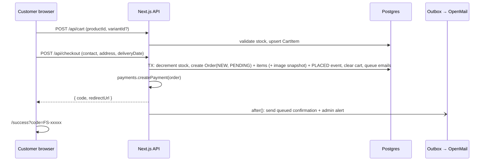
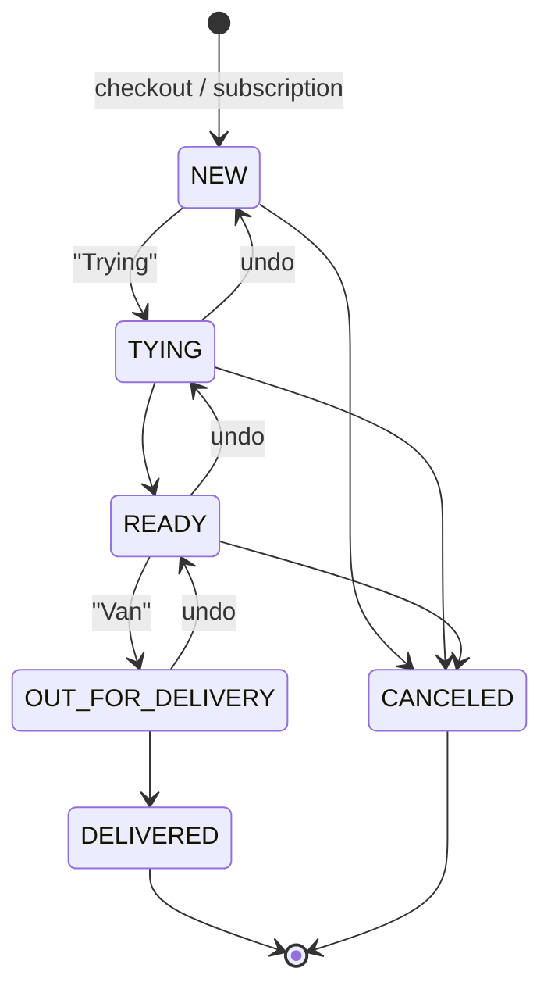
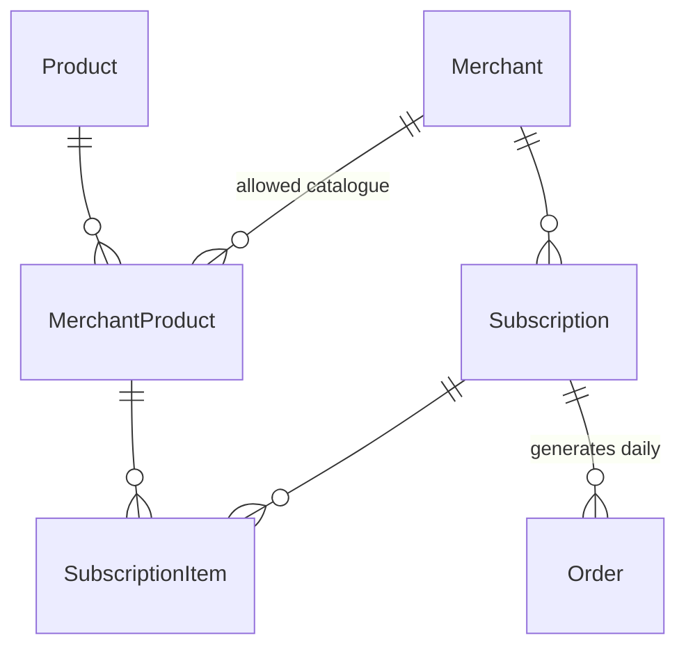

# Zoecomsos — System Workflow

How the shop works end to end. Read this before you change ordering, delivery, notification, or subscription code.

---

## 1. Stack and module map

| Concern | Technology | Where |
|---|---|---|
| Web app | Next.js 15 App Router, React 19 | `src/app/**` |
| Database | PostgreSQL through Prisma 5 | `prisma/schema.prisma`, `src/lib/prisma.ts` |
| Auth | Clerk; app roles `CUSTOMER`, `STAFF`, `OWNER` | `src/middleware.ts`, `src/lib/auth.ts` (memoized per render), `src/lib/auth-helpers.ts` |
| Catalogue cache | `unstable_cache`, tag `catalog` | `src/lib/catalog.ts` (`invalidateCatalog()`) |
| Settings cache | `unstable_cache`, tag `settings` | `src/lib/delivery-config.ts` (`invalidateSettings()`) |
| Redis | Upstash or ioredis, used **only** for rate limiting | `src/lib/redis.ts`, `src/lib/rate-limit.ts` |
| Image storage | S3-compatible bucket; the browser uploads through a presigned PUT URL | `src/lib/upload.ts`, `src/app/api/admin/upload-url` |
| Email | OpenMail REST API, sent through an outbox table | `src/lib/order-notifications.ts` (builders), `src/lib/notifications.ts` (outbox) |
| Order status rules | Allowed transitions and labels | `src/lib/order-status.ts` |
| Payments | Integration point (manual today) | `src/lib/payments.ts`, `src/app/api/payments/webhook` |
| Scheduled work | Vercel Cron → daily job | `vercel.json`, `src/app/api/cron/daily`, `src/lib/jobs/daily.ts` |
| Shop timezone | `Asia/Kolkata` (IST); money is INR stored in paise | `src/lib/delivery-date.ts`, `src/lib/currency.ts` |

**Money rule.** Every amount is an integer in paise (`49900` = ₹499). Format it only with `formatMoney()`. Admin forms take rupees and convert.

**Date rule.** `Order.deliveryDate` holds the IST calendar date as UTC midnight: `2026-11-20T00:00:00.000Z` means 20 Nov in IST. Get days with `shopDay(offset)` / `shopDayKey(offset)` from `src/lib/delivery-date.ts`. Never use `new Date().setHours(0)`, because servers run in UTC.

---

## 2. Roles and access

| Role | Assigned by | Access |
|---|---|---|
| `CUSTOMER` | Default | Storefront, `/account/*` |
| `STAFF` | `ADMIN_EMAIL` env (verified) or `User.role` | `/admin/*` except Settings |
| `OWNER` | `OWNER_EMAIL` env (verified) | Everything, including `/admin/settings` (delivery charges, hours) |

Every `/api/admin/*` handler starts with `requireStaff()` or `requireOwner()`. The cron route is guarded by `CRON_SECRET`.

---

## 3. Catalogue: products, variants, images

**Data.** A `Product` has many `ProductVariant`s and many `ProductImage`s. Stock lives **only** on variants, so a product with no variant cannot be sold.

- Unit price = `Product.basePrice + ProductVariant.priceDelta`, plus the optional vase add-on.
- `Product.status`: `ACTIVE` is visible in the storefront. `DRAFT` and `ARCHIVED` are admin-only, and archived product pages return 404.

**Admin** (`/admin/products`, `/admin/products/[id]`):

| Action | How |
|---|---|
| Create product | `POST /api/admin/products`. The same transaction creates a "Standard" variant with the starting stock, so the product is sellable immediately. |
| Add variant | "Add" row in the Variants table → `POST /api/admin/products/[id]/variants`. A duplicate SKU returns 409. |
| Edit / delete variant | `PATCH` / `DELETE /api/admin/products/[id]/variants/[variantId]`. Deleting a variant removes it from carts; past orders keep their snapshot. |
| Archive | `DELETE /api/admin/products/[id]`. Hides the product; set it back to Active to restore it. |
| Delete permanently | `DELETE /api/admin/products/[id]?hard=1`. Cart lines cascade, and the stored image files are deleted. Past orders keep their name, price and image snapshot. |
| Photos | Multi-upload, resized in the browser to ≤1600px WebP, then `POST …/images`. Only URLs from our own bucket under `products/<id>/` are accepted. Set primary, alt text, reorder (`PUT …/images` with the full id order), and remove (also deletes the stored file). |
| List | Filter by status (Archived is hidden by default), 50 per page, primary-photo thumbnails. |

Every catalogue mutation calls `invalidateCatalog()`.

---

## 4. Customer ordering flow



1. **Cart.** Signed-in carts are keyed by `userId`; anonymous carts by the `fs_cart` httpOnly cookie. The two merge on the first signed-in `GET /api/cart`.
2. **Checkout** (`src/app/api/checkout/route.ts`):
   - It is rate-limited, validated with `checkoutSchema`, and runs `auth()` once.
   - Delivery is always **scheduled**: the customer picks a date from tomorrow to +30 days (IST).
   - Prices and the delivery fee are recomputed on the server, and stock is decremented with a race-safe guard.
   - Money and line items (`productName`, `variantLabel`, `unitPrice`, `imageUrl`) are snapshots. Later catalogue edits never change past orders.
   - Emails are written to the outbox in the same transaction and sent after the response is returned, so the customer never waits on the mail API.
3. **Success page.** It shows the ordered items with their images and the message: *"Your order has been received. A member of our team will contact you shortly to confirm the details, and your order will be on its way to you soon."*
4. **Tracking.** `/account/orders/[code]` shows the status, item images, and a timeline. Staff `NOTE` events are hidden from customers.

---

## 5. Payment gateway integration point

`src/lib/payments.ts` exports `payments: PaymentProvider`. Today it is `manualProvider`: there is no online payment, and staff click **Mark paid** in the admin.

```ts
interface PaymentProvider {
  name: string;
  createPayment(order): Promise<{ ref: string | null; redirectUrl: string | null }>;
  parseWebhook(req: Request): Promise<{ ref: string; status: "PAID" | "FAILED" | "REFUNDED" } | null>;
}
```

To add a gateway:

1. Implement an adapter and assign it to `payments`.
2. Checkout already stores the returned `ref` in `Order.paymentRef` (unique), and the checkout page already redirects to `redirectUrl` when it is set.
3. Point the gateway's webhook at `POST /api/payments/webhook`. `parseWebhook` **must** verify the signature. The route updates `paymentStatus` idempotently and appends a `PAID` or `REFUNDED` event.
4. Decide on auto-cancelling unpaid orders, which would release the stock reserved at checkout.

---

## 6. Order status lifecycle and email triggers



- **Where statuses change:** only in the admin, through `PATCH /api/admin/orders/[id]`. Both the Deliveries board drag and the order-detail buttons call it.
- **Validation:** `canTransition()` rejects illegal moves with 409, and the board rejects them before calling the API. The update is conditional on the current status, so two staff moving the same card at once can't both succeed.
- **Cancel:** returns variant stock in the same transaction. `CANCELED` is final, so stock is never double-counted.
- **History:** every change appends an `OrderEvent` with `fromStatus`, `toStatus`, and `actorId`. The admin order timeline shows "Tying → Ready" and who did it.

| Event | Customer email | Admin email | Contents |
|---|---|---|---|
| Order placed | "Order received" | "New order FS-…" | Items with product images (customer email) |
| Enters `TYING` | "We have started preparing your order." | — | Items with product images |
| Enters `OUT_FOR_DELIVERY` | "Your order is in the van and out for delivery." | — | Items with product images |
| Delivery date reached | — | "Deliveries for YYYY-MM-DD" digest | All of the day's open orders |

**Outbox details.**
- Each email is one `Notification` row with a unique `dedupeKey` (for example `status:FS-12345:TYING`). Dragging a card back and forth never re-sends.
- The key is also sent to OpenMail as `Idempotency-Key`.
- A failed send is marked `FAILED` with the reason. It is retried by the daily job (up to 3 attempts) or from the Mail service panel.

---

## 7. Admin Deliveries tab

Route: `/admin/deliveries?day=today|yesterday`.

- **Which orders:** those whose `deliveryDate` is the selected IST day, in **every** status. Columns: New, Tying, Ready · awaiting van, Out for delivery, Delivered, Canceled. Nothing disappears after its last move, and yesterday's orders stay visible on the Yesterday tab.
- **Cards:** show the code, delivery window, recipient (or merchant name), city, total, and each item's thumbnail, name, variant and quantity. Drag to change status, or click to open the order.
- **Products for the day:** quantities summed per product and variant, excluding canceled orders.
- **Mail service:** every email for the day's orders, plus that day's admin digest, with its status and a **Retry** button for unsent ones.
- **ⓘ tooltips:** next to Today, Yesterday, and Mail service, explaining what each contains.

---

## 8. Scheduled orders and the daily job

- **Trigger:** `vercel.json` runs `GET /api/cron/daily` at `30 0 * * *` (06:00 IST). The route requires `Authorization: Bearer ${CRON_SECRET}`; set `CRON_SECRET` in Vercel.
- **Steps** (`src/lib/jobs/daily.ts`), safe to re-run:
  1. **Subscription orders.** For each `ACTIVE` merchant subscription with `nextDelivery ≤ today`, create one order for today (only one per subscription per day), then advance `nextDelivery`. When `totalCycles` is reached, the subscription is canceled.
  2. **Admin digest.** Queue one email per admin (`OWNER_EMAIL`, `ADMIN_EMAIL`) listing every open order whose delivery date is today.
  3. **Flush the outbox.** Send pending emails and retry failed ones.
- **Manual run:** `curl -H "Authorization: Bearer $CRON_SECRET" https://<host>/api/cron/daily`.

---

## 9. Merchant stores and subscriptions

Subscriptions are **only** for merchant stores: business customers such as cafés, hotels and offices. The storefront no longer offers self-serve subscriptions; it shows a "For businesses — contact our team" section.



- **`/admin/merchants`:** list stores and add a new one.
- **`/admin/merchants/[id]`:**
  - Edit the store, deactivate it, or delete it.
  - **Products for this merchant:** pick a product (and optionally a variant) and an optional agreed price in ₹. Lines can be paused or removed.
  - **Subscriptions:** cadence (weekly, fortnightly, monthly), first delivery date, optional number of deliveries, and quantities of the merchant's products. The API rejects products that don't belong to the merchant.
- **`/admin/subscriptions`:** every subscription, with pause, resume and cancel. Legacy customer subscriptions (created before merchants existed) can't be resumed.
- **Pricing:** a generated order uses the agreed price, or else the catalogue price, with no delivery fee. Stock is reserved when available. Any shortfall is noted on the order timeline.

---

## 10. Delivery charge configuration

- **Storage:** the `Setting` row `shop.delivery`, validated by `deliverySettingsSchema` in `src/lib/delivery-config.ts`.
- **Editing:** `/admin/settings` (owner only): **Delivery charge (₹)** and **Free delivery over (₹)**. Leave the second blank for "never free". Saving invalidates the settings cache, so the next cart uses the new values.
- **Applied in:** `priceCart()` → `deliveryFee()` (`src/lib/pricing.ts`). Courier deliveries cost exactly the configured fee, and the fee is ₹0 once the subtotal reaches the free threshold. The fee is snapshotted onto `Order.deliveryFee`, so changes never affect existing orders.

---

## 11. Performance notes

- **Admin:** `src/app/admin/loading.tsx` shows a skeleton instantly on navigation. `auth()` is memoized per render and only writes to the `User` row when the Clerk profile changed. Lists are paginated.
- **Storefront:** server components read through the cached catalogue. Product images use `next/image` (AVIF/WebP, responsive `sizes`, 30-day cache), and uploads are downscaled before storage. Add your storage host via `S3_PUBLIC_URL`; it is allowed automatically.
- **Emails:** never sent inline. They go through the outbox and `after()`.
- **Redis:** rate limiting costs one round trip per request (two on the first hit of a window). It does not cache pages.
- **Measuring:**
  - Use `npm run build && npm start`, not dev mode.
  - In Chrome DevTools → Network, filter `_rsc` and compare TTFB with download time.
  - Check function duration and region in the Vercel logs.

---

## 12. Admin dark mode

The toggle in the admin top bar switches `data-theme` on `.ad-frame` and stores it in the `ad_theme` cookie. `admin/layout.tsx` reads the cookie on the server, so the page renders in the right theme without a flash. All admin colours are `--ad-*` CSS variables in `src/app/admin/admin.css`, and the dark palette overrides them under `.ad-frame[data-theme="dark"]`. Storefront styles are unaffected.

---

## 13. Getting started

1. `npm install`, copy `env.example` to `.env`, and fill in the database, Clerk, storage, OpenMail and `CRON_SECRET` values.
2. `npm run setup`. This applies migrations (including `20261119120000_merchants_notifications_status_history`) and seeds demo data: products, orders for today and yesterday, and a merchant with a subscription.
3. `npm run dev`. Sign in with the `OWNER_EMAIL` account and open `/admin/deliveries`.
4. Place an order on the storefront for tomorrow, then run the daily job for that date and follow the order through the board and the customer's `/account/orders/[code]` page.
5. Tests: `npm test` (Vitest) and `npm run test:e2e` (Playwright).
